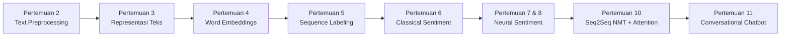

# 📚 Pemrosesan Bahasa Alami (Natural Language Processing) — Semester 5

<p align="center">
  
  
  
  
  
  
  
  
</p>

Repositori ini berisi seluruh dokumentasi pembelajaran, latihan praktikum mingguan, eksperimen model, dan *mini project* untuk mata kuliah **Pemrosesan Bahasa Alami (Natural Language Processing / NLP)** pada Semester 5, Program Studi **S1 Teknik Informatika**, Departemen Teknik Elektro dan Informatika, **Universitas Negeri Malang (UM)**.

Cakupan materi dimulai dari fondasi *Classical NLP* (preprocessing, representasi teks, dan machine learning berbasis aturan/probabilistik), *Word Embeddings*, *Sequence Labeling*, hingga pemodelan *Deep Learning* modern (*Recurrent Neural Networks*, *Seq2Seq Machine Translation* dengan *Bahdanau Attention*, serta *Conversational Chatbot*).

---

## 📑 Daftar Isi

- [Informasi Akademik](#-informasi-akademik)
- [Peta Pembelajaran & Silabus](#-peta-pembelajaran--silabus)
- [Rincian Praktikum & Proyek](#-rincian-praktikum--proyek)
  - [Pertemuan 02: Text Preprocessing Eksploratif](#pertemuan-02-text-preprocessing-eksploratif)
  - [Pertemuan 03: Representasi Teks (BoW & TF-IDF)](#pertemuan-03-representasi-teks-bow--tf-idf)
  - [Pertemuan 04: Word Embeddings (Word2Vec, GloVe & FastText)](#pertemuan-04-word-embeddings-word2vec-glove--fasttext)
  - [Pertemuan 05: Sequence Labeling & Named Entity Recognition (NER)](#pertemuan-05-sequence-labeling--named-entity-recognition-ner)
  - [Pertemuan 06: Analisis Sentimen — Classical NLP](#pertemuan-06-analisis-sentimen--classical-nlp)
  - [Pertemuan 07: Analisis Sentimen — Neural Networks](#pertemuan-07-analisis-sentimen--neural-networks)
  - [Pertemuan 08: Lanjutan Deep Learning & Generalisasi Model](#pertemuan-08-lanjutan-deep-learning--generalisasi-model)
  - [Pertemuan 10: Mini Project — Neural Machine Translation (Seq2Seq + Attention)](#pertemuan-10-mini-project--neural-machine-translation-seq2seq--attention)
  - [Pertemuan 11: Conversational Chatbot — Retrieval vs Neural Network](#pertemuan-11-conversational-chatbot--retrieval-vs-neural-network)
- [Struktur Repositori](#-struktur-repositori)
- [Teknologi & Library](#-teknologi--library)
- [Panduan Instalasi & Menjalankan](#-panduan-instalasi--menjalankan)
- [Ucapan Terima Kasih](#-ucapan-terima-kasih)

---

## 🎓 Informasi Akademik

| Komponen | Keterangan |
| :--- | :--- |
| **Mata Kuliah** | Pemrosesan Bahasa Alami (Natural Language Processing) |
| **Semester / Tahun** | Semester 5 / Ganjil 2024–2025 |
| **Program Studi** | S1 Teknik Informatika |
| **Jurusan / Dept.** | Teknik Elektro dan Informatika (TEI) |
| **Fakultas / Univ.** | Fakultas Teknik — Universitas Negeri Malang (UM) |
| **Mahasiswa** | **Asyam Sakhi Maulana** (NIM: `240535600363`) |
| **Dosen Pengampu** | Prof. Aji Prasetya Wibawa, S.T., M.M.T., Ph.D.<br>M. Zainal Arifin, S.Si., M.Kom., Ph.D. |
| **Mentor Praktikum** | Agung Bella Putra Utama & Fadia Irsania Putri |

---

## 🗺️ Peta Pembelajaran & Silabus



| Pertemuan | Topik Utama | Metode / Model | Dataset | Notebook Utama |
| :---: | :--- | :--- | :--- | :---: |
| **02** | Text Preprocessing | Tokenization, Stopwords, Stemming (Porter & Sastrawi) | Purple Cow & Kalimat Sampel | [Buka](<./Pertemuan_2_NLP_Mengekplor_Text_Prepocessing.ipynb>) |
| **03** | Representasi Teks | One-Hot, Bag-of-Words, TF-IDF, Cosine Similarity | Dokumen Sampel Buku | [Buka](<./[Submit]Pertemuan_3_NLP_representasi_teks.ipynb>) |
| **04** | Word Embeddings | Word2Vec (CBOW vs Skip-Gram), GloVe Co-occurrence, FastText OOV | Korpus Teks Bahasa Inggris & Indonesia | [Buka](<./[Submit]Pertemuan_4_Word_embeddings.ipynb>) |
| **05** | Sequence Labeling & NER | POS Tagging (NLTK), spaCy NER, BIO/IOB Tagging Scheme | Korpus Kalimat Entitas Bisnis & Brand | [Buka](<./[Submit]Praktikum_5_Sequence Labeling.ipynb>) |
| **06** | Classical Sentiment Analysis | TF-IDF + Multinomial Naive Bayes, Logistic Regression, SVM | Komentar TikTok Progres IKN | [Buka](<./[Submit]Praktikum_6__Analisis_Sentimen_IKN.ipynb>) |
| **07** | Deep Learning Sentiment | Embedding + ANN, SimpleRNN, LSTM, GRU, BiLSTM | Komentar TikTok Progres IKN | [Buka](<./[Submit]Praktikum_7_Analisis_Sentimen_Neural_Network.ipynb>) |
| **08** | Lanjutan Deep Learning | Embedding 100d + RNN/LSTM/GRU + External Test Generalization | Twitter Sentiment Analysis Dataset | [Buka](<./[Submit]Praktikum_8_lanjutanAnalisis_Sentimen_Neural_Network.ipynb>) |
| **10** | Mini Project: Machine Translation | Seq2Seq Encoder–Decoder (No Attention vs Bahdanau Attention) | Paralel PANL-BPPT (ID ➔ EN) | [Buka](<./pertemuan 10/SUbmit pertemuan 10 Mini_Project_MT_PANL_BPPT_FINAL_(1).ipynb>) |
| **11** | Conversational Chatbot | Model 1: Retrieval (TF-IDF + Cosine Sim)<br>Model 2: Neural Classifier (Embedding + GRU/LSTM) | IndoHealth & FAQ Chatbot Dataset | [Buka](<./Pertemuan 11/submitChatbot_Pertemuan11.ipynb>) |

---

## 🔬 Rincian Praktikum & Proyek

### Pertemuan 02: Text Preprocessing Eksploratif
- **Tujuan:** Memahami fondasi pembersihan data teks mentah sebelum masuk ke tahap pemodelan komputasi.
- **Tahapan & Eksperimen:**
  - Case folding (menyeragamkan teks ke huruf kecil).
  - Regex filtering untuk tanda baca, angka, dan karakter non-alfanumerik.
  - Tokenisasi kata dan karakter menggunakan library `nltk`.
  - Penghapusan stopword (bahasa Inggris menggunakan NLTK stopwords dan bahasa Indonesia menggunakan Sastrawi).
  - Stemming menggunakan algoritma *Porter Stemmer* untuk mengembalikan kata berimbuhan ke kata dasarnya.
  - Analisis distribusi frekuensi kata menggunakan `collections.Counter` untuk mengamati 10 token paling dominan.
- **Berkas:** [`Pertemuan_2_NLP_Mengekplor_Text_Prepocessing.ipynb`](<./Pertemuan_2_NLP_Mengekplor_Text_Prepocessing.ipynb>)

---

### Pertemuan 03: Representasi Teks (BoW & TF-IDF)
- **Tujuan:** Mengonversi data teks diskrit menjadi representasi numerik matriks yang dapat diproses algoritma machine learning.
- **Tahapan & Eksperimen:**
  - Pembangunan *vocabulary* unik dari kumpulan dokumen.
  - Representasi biner (*One-Hot / Binary BoW*) dan penghitungan kemunculan frekuensi kata (*CountVectorizer*).
  - Pembobotan **TF-IDF (Term Frequency - Inverse Document Frequency)** menggunakan `TfidfVectorizer` untuk meredam kata yang terlalu sering muncul di semua dokumen.
  - Perhitungan derajat kesamaan semantik antar-dokumen dengan matriks **Cosine Similarity**.
- **Berkas:**
  - Latihan: [`[Latihan]Pertemuan_3_NLP_representasi_teks.ipynb`](<./[Latihan]Pertemuan_3_NLP_representasi_teks.ipynb>)
  - Tugas/Submit: [`[Submit]Pertemuan_3_NLP_representasi_teks.ipynb`](<./[Submit]Pertemuan_3_NLP_representasi_teks.ipynb>)

---

### Pertemuan 04: Word Embeddings (Word2Vec, GloVe & FastText)
- **Tujuan:** Memahami representasi vektor kata padat (*dense distributed representation*) yang menangkap relasi semantik dan sintaktik.
- **Tahapan & Eksperimen:**
  - Perbandingan paradigma Word2Vec: **Continuous Bag-of-Words (CBOW)** (memprediksi kata target dari konteks) vs **Skip-Gram** (memprediksi konteks dari kata target).
  - Eksperimen perhitungan manual matriks *Co-occurrence* sebagai fondasi model **GloVe (Global Vectors for Word Representation)**.
  - Analisis kedekatan makna kata (*semantic proximity*) menggunakan *Cosine Similarity* pada ruang vektor laten.
  - Eksplorasi keunggulan **FastText** dalam menangani masalah kata tak dikenal (*Out-of-Vocabulary / OOV*) melalui representasi berbasis sub-kata (*character n-grams*).
- **Berkas:**
  - Latihan: [`[Latihan]Pertemuan_4_Word_embeddings.ipynb`](<./[Latihan]Pertemuan_4_Word_embeddings.ipynb>)
  - Tugas/Submit: [`[Submit]Pertemuan_4_Word_embeddings.ipynb`](<./[Submit]Pertemuan_4_Word_embeddings.ipynb>)

---

### Pertemuan 05: Sequence Labeling & Named Entity Recognition (NER)
- **Tujuan:** Mengekstrak entitas bernama dan memberi label kelas kata pada setiap posisi token dalam kalimat.
- **Tahapan & Eksperimen:**
  - **Part-of-Speech (POS) Tagging** menggunakan model *Penn Treebank* pada library NLTK (`nltk.pos_tag`).
  - **Named Entity Recognition (NER)** menggunakan model *pre-trained* spaCy (`en_core_web_sm`) untuk mendeteksi entitas `ORG` (organisasi), `MONEY` (mata uang/nominal), `PERSON`, dan lainnya.
  - Penerapan skema **BIO / IOB Tagging** (`B-` *Begin*, `I-` *Inside*, `O-` *Outside*).
  - Evaluasi akurasi prediksi model terhadap anotasi *gold standard* pada level token.
- **Berkas:** [`[Submit]Praktikum_5_Sequence Labeling.ipynb`](<./[Submit]Praktikum_5_Sequence Labeling.ipynb>)

---

### Pertemuan 06: Analisis Sentimen — Classical NLP
- **Tujuan:** Mengklasifikasikan polaritas sentimen masyarakat terhadap pembangunan Ibu Kota Nusantara (IKN) dari komentar TikTok.
- **Dataset:** Komentar TikTok Progres IKN (positif, netral, negatif).
- **Tahapan & Eksperimen:**
  - Text preprocessing khusus Bahasa Indonesia: pembersihan mention, hashtag, tanda baca, slang words, serta normalisasi imbuhan.
  - Ekstraksi fitur teks menggunakan `TfidfVectorizer` (unigram & bigram).
  - Perbandingan performa tiga model *Classical Machine Learning*:
    1. **Multinomial Naive Bayes (MNB)**
    2. **Logistic Regression (LogReg)**
    3. **Support Vector Machine (Linear SVM)**
  - Evaluasi kuantitatif: *Accuracy*, *Precision*, *Recall*, *Macro F1-Score*, dan visualisasi *Confusion Matrix*.
- **Berkas:** [`[Submit]Praktikum_6__Analisis_Sentimen_IKN.ipynb`](<./[Submit]Praktikum_6__Analisis_Sentimen_IKN.ipynb>)

---

### Pertemuan 07: Analisis Sentimen — Neural Networks
- **Tujuan:** Mengimplementasikan pendekatan *Deep Learning* berurutan (*sequential models*) untuk memodelkan ketergantungan urutan kata dalam analisis sentimen.
- **Tahapan & Eksperimen:**
  - Tokenisasi teks menggunakan Keras Tokenizer dan *Sequence Padding* untuk menyamakan panjang input.
  - Pemanfaatan *Embedding Layer* yang dapat dilatih (*trainable embeddings*).
  - Perbandingan 5 variasi arsitektur Neural Network:
    1. **Artificial Neural Network (Dense / ANN)**
    2. **Simple Recurrent Neural Network (SimpleRNN)**
    3. **Long Short-Term Memory (LSTM)**
    4. **Gated Recurrent Unit (GRU)**
    5. **Bidirectional LSTM (BiLSTM)**
  - Analisis kurva konvergensi *loss* dan *accuracy* terhadap jumlah epoch.
- **Berkas:** [`[Submit]Praktikum_7_Analisis_Sentimen_Neural_Network.ipynb`](<./[Submit]Praktikum_7_Analisis_Sentimen_Neural_Network.ipynb>)

---

### Pertemuan 08: Lanjutan Deep Learning & Generalisasi Model
- **Tujuan:** Menguji ketahanan dan generalisasi arsitektur *gated recurrent neural network* pada *external test set* yang independen.
- **Dataset:** Kaggle Twitter Sentiment Analysis (tersedia partisi `train`, `validation`, dan `external test set`).
- **Tahapan & Eksperimen:**
  - Konfigurasi parameter: Vocabulary maksimum 10.000 kata, dimensi embedding 100, regularisasi *Dropout*.
  - Eksperimen arsitektur: ANN, RNN, LSTM, GRU, dan *Bidirectional Gated Network*.
  - Evaluasi menyeluruh kurva *Training vs Validation Loss* untuk mendeteksi tanda-tanda *overfitting*.
  - Uji akhir pada *external test set* tanpa modifikasi data untuk validasi performa dunia nyata.
- **Berkas:** [`[Submit]Praktikum_8_lanjutanAnalisis_Sentimen_Neural_Network.ipynb`](<./[Submit]Praktikum_8_lanjutanAnalisis_Sentimen_Neural_Network.ipynb>)

---

### Pertemuan 10: Mini Project — Neural Machine Translation (Seq2Seq + Attention)
- **Tujuan:** Membangun sistem *Machine Translation* Bahasa Indonesia ke Bahasa Inggris dengan membandingkan arsitektur *Sequence-to-Sequence* konvensional melawan model berbasis mekanisme *Attention*.
- **Identitas Proyek:** **Kelompok 1A TIA** (Ketua: Asyam Sakhi Maulana).
- **Dataset:** Korpus Paralel **PANL-BPPT** (Bahasa Indonesia — Bahasa Inggris) lintas empat topik: ekonomi, internasional, sains & teknologi, dan olahraga.
- **Arsitektur Model yang Dibandingkan:**
  1. **Seq2Seq Encoder–Decoder Standar:**
     - Decoder hanya menerima satu *context vector* tetap dari *hidden state* terakhir encoder (mengalami *bottleneck* pada kalimat panjang).
  2. **Seq2Seq Encoder–Decoder dengan Bahdanau (Additive) Attention:**
     - Pada setiap langkah *decoding*, model menghitung bobot perhatian (*attention weights*) dinamis ke seluruh *hidden states* encoder, memungkinkan decoder memfokuskan kata relevan secara selektif.
- **Metodologi & Pengujian:**
  - Preprocessing terpadu: pemisahan tanda baca, filtering rasio panjang token 0.5–2.0, audit inkonsistensi data.
  - Training dengan *Teacher Forcing* dan *cross-entropy loss*.
  - Evaluasi performa terjemahan menggunakan metrik **BLEU Score** (*Bilingual Evaluation Understudy*).
  - Evaluasi performa berdasarkan strata panjang kalimat: **Pendek** (≤12 token), **Sedang** (13–24 token), dan **Panjang** (≥25 token).
  - Visualisasi matriks penyelarasan (*attention alignment heatmap*).
- **Berkas:**
  - Notebook Mini Project: [`SUbmit pertemuan 10 Mini_Project_MT_PANL_BPPT_FINAL_(1).ipynb`](<./pertemuan 10/SUbmit pertemuan 10 Mini_Project_MT_PANL_BPPT_FINAL_(1).ipynb>)
  - Materi Pembelajaran: [`NLP Pertemuan #10 Seq2seq.pdf`](<./pertemuan 10/NLP Pertemuan #10 Seq2seq.pdf>)
  - Dataset Paralel: [`dataset_id_en.csv`](<./pertemuan 10/dataset_id_en.csv>)

---

### Pertemuan 11: Conversational Chatbot — Retrieval vs Neural Network
- **Tujuan:** Membangun dan membandingkan sistem *dialogue agent* / *chatbot* untuk klasifikasi maksud (*intent classification*) dan pembalasan pesan interaktif.
- **Dataset:** Dataset Tanya-Jawab Layanan dan Kesehatan (*IndoHealth / Conversational FAQ Dataset*).
- **Model yang Diimplementasikan:**
  1. **Model 1: Chatbot Retrieval (TF-IDF + Cosine Similarity)**
     - Menghitung representasi n-gram TF-IDF pada query pengguna, lalu mencocokkan kemiripan kosinus terhadap basis data tanya-jawab untuk mengambil respon paling relevan.
  2. **Model 2: Chatbot Neural Network (Embedding + GRU / LSTM Classifier)**
     - Tokenisasi ➔ Sequence Padding ➔ Dense Embedding ➔ Recurrent Layer (GRU/LSTM) ➔ Dense Softmax Intent Classifier.
- **Eksperimen & Pengujian Khusus:**
  - Evaluasi metrik kuantitatif: *Accuracy* dan *Macro F1-Score* pada data uji tersamar (*stratified test split*).
  - **Uji Ketahanan Kalimat Ekstrem (*Robustness Testing*):** Uji coba menggunakan 26 kalimat baru dengan variasi kata slang, singkatan bahasa percakapan, kalimat majemuk panjang (≥10 kata), dan *typo*.
  - Analisis kesalahan prediksi (*Error Analysis*) dan studi kasus komparatif.
- **Berkas:**
  - Notebook Chatbot: [`submitChatbot_Pertemuan11.ipynb`](<./Pertemuan 11/submitChatbot_Pertemuan11.ipynb>)
  - Materi Pembelajaran: [`NLP Pertemuan #11.pdf`](<./Pertemuan 11/NLP Pertemuan #11.pdf>)
  - Dataset: [`dataset_chatbot.xlsx`](<./Pertemuan 11/dataset_chatbot.xlsx>), [`IndoHealth_NLP_NCD_Instruct_QA_Sample.csv`](<./Pertemuan 11/IndoHealth_NLP_NCD_Instruct_QA_Sample.csv>)

---

## 📂 Struktur Repositori

```plaintext
NLP-Semester-5/
│
├── .gitignore                                           # File pengabaian Git
├── requirements.txt                                     # Daftar dependensi modul Python
├── README.md                                            # Dokumentasi utama proyek
│
├── Pertemuan_2_NLP_Mengekplor_Text_Prepocessing.ipynb   # Praktikum 2: Preprocessing Teks
├── [Latihan]Pertemuan_3_NLP_representasi_teks.ipynb     # Latihan 3: BoW & TF-IDF
├── [Submit]Pertemuan_3_NLP_representasi_teks.ipynb      # Tugas 3: Representasi Teks & Cosine Sim
├── [Latihan]Pertemuan_4_Word_embeddings.ipynb           # Latihan 4: Word Embeddings
├── [Submit]Pertemuan_4_Word_embeddings.ipynb            # Tugas 4: Word2Vec, GloVe & FastText
├── [Submit]Praktikum_5_Sequence Labeling.ipynb          # Praktikum 5: POS Tagging & NER spaCy
├── [Submit]Praktikum_6__Analisis_Sentimen_IKN.ipynb     # Praktikum 6: Classical Sentiment (TF-IDF + SVM/NB)
├── [Submit]Praktikum_7_Analisis_Sentimen_Neural_Network.ipynb   # Praktikum 7: Neural Sentiment (ANN-BiLSTM)
├── [Submit]Praktikum_8_lanjutanAnalisis_Sentimen_Neural_Network.ipynb # Praktikum 8: Deep Learning Generalization
│
├── pertemuan 10/                                        # Mini Project: Neural Machine Translation
│   ├── NLP Pertemuan #10 Seq2seq.pdf                    # Slide materi Seq2Seq & Attention
│   ├── Coding Colab - Machine Translation.ipynb         # Eksplorasi dasar NMT
│   ├── SUbmit pertemuan 10 Mini_Project_MT_PANL_BPPT_FINAL_(1).ipynb # Laporan final Mini Project NMT
│   └── dataset_id_en.csv                                # Korpus paralel Indonesia-Inggris (PANL-BPPT)
│
└── Pertemuan 11/                                        # Praktikum: Conversational Chatbot
    ├── NLP Pertemuan #11.pdf                            # Slide materi Chatbot Retrieval & Neural
    ├── Chatbot - Pertemuan11.ipynb                      # Eksperimen alur chatbot
    ├── submitChatbot_Pertemuan11.ipynb                  # Laporan final evaluasi chatbot
    ├── dataset_chatbot.xlsx                             # Dataset intent chatbot primer
    ├── IndoHealth_NLP_NCD_Instruct_QA_Sample.csv        # Sampel QA kesehatan IndoHealth
    └── Processed Dataset.csv                            # Dataset hasil preprocessing
```

---

## 🛠️ Teknologi & Library

Proyek ini dibangun menggunakan ekosistem bahasa pemrograman **Python 3.9+** dengan dukungan pustaka utama:

- **Pemrosesan Teks & Linguistik:**
  - [NLTK](https://www.nltk.org/) — Tokenisasi, stopword removal, part-of-speech tagging.
  - [spaCy](https://spacy.io/) — Industrial-strength NLP & named entity recognition (`en_core_web_sm`).
  - [PySastrawi](https://github.com/harisbc/PySastrawi) — Stemming & stopword khusus Bahasa Indonesia.
  - [Gensim](https://radimrehurek.com/gensim/) — Word2Vec & vector space modeling.
- **Deep Learning & Frameworks:**
  - [PyTorch](https://pytorch.org/) — Implementasi arsitektur Sequence-to-Sequence & Bahdanau Attention.
  - [TensorFlow / Keras](https://www.tensorflow.org/) — Pemodelan Dense ANN, SimpleRNN, LSTM, GRU, dan BiLSTM.
- **Machine Learning & Evaluasi:**
  - [Scikit-Learn](https://scikit-learn.org/) — `CountVectorizer`, `TfidfVectorizer`, Naive Bayes, Logistic Regression, SVM, pembagian dataset stratified, dan metrik evaluasi (`classification_report`, `confusion_matrix`, BLEU).
- **Analisis Data & Visualisasi:**
  - [Pandas](https://pandas.pydata.org/) & [NumPy](https://numpy.org/) — Manipulasi tabel korpus dan komputasi matriks.
  - [Matplotlib](https://matplotlib.org/) & [Seaborn](https://seaborn.pydata.org/) — Visualisasi kurva training, grafik evaluasi performa, dan heatmap attention.

---

## 🚀 Panduan Instalasi & Menjalankan

### Opsi 1: Menjalankan Secara Lokal

1. **Clone repositori ini:**
   ```bash
   git clone https://github.com/sakhiasyam18/NLP-Semester-5.git
   cd NLP-Semester-5
   ```

2. **Buat dan aktifkan lingkungan virtual (virtual environment):**
   ```bash
   # Windows
   python -m venv venv
   .\venv\Scripts\activate

   # Linux / macOS
   python3 -m venv venv
   source venv/bin/activate
   ```

3. **Install seluruh dependensi paket:**
   ```bash
   pip install --upgrade pip
   pip install -r requirements.txt
   ```

4. **Unduh korpus bahasa untuk NLTK dan spaCy:**
   ```bash
   python -m spacy download en_core_web_sm
   python -c "import nltk; nltk.download('punkt'); nltk.download('stopwords'); nltk.download('averaged_perceptron_tagger')"
   ```

5. **Jalankan Jupyter Notebook / JupyterLab:**
   ```bash
   jupyter lab
   ```

---

### Opsi 2: Menjalankan di Google Colab

Seluruh file notebook (`.ipynb`) dalam repositori ini telah dirancang agar kompatibel dengan lingkungan **Google Colab**. Anda dapat langsung mengunggah notebook atau membukanya langsung via URL GitHub di Colab:

```text
https://colab.research.google.com/github/sakhiasyam18/NLP-Semester-5/blob/main/<Nama_Notebook>.ipynb
```

Pastikan Anda menyetel runtime Colab ke **GPU** (T4 / V100) saat menjalankan notebook yang melibatkan *Deep Learning* (Pertemuan 7, 8, 10, dan 11) untuk proses pelatihan yang jauh lebih cepat.

---

## 💡 Temuan Penting & Evaluasi Model

1. **Efektivitas Mekanisme Attention pada NMT (Pertemuan 10):**
   - Model Seq2Seq tanpa Attention mengalami penurunan skor BLEU yang sangat tajam pada kalimat panjang (≥25 token) akibat *information bottleneck* pada vektor representasi tunggal.
   - Penambahan **Bahdanau Attention** secara konsisten mempertahankan skor BLEU pada kalimat panjang dan menghasilkan matriks *alignment* kata yang transparan dan dapat diinterpretasikan secara linguistik.
2. **Gated Units vs SimpleRNN (Pertemuan 7 & 8):**
   - LSTM dan GRU secara konsisten mengungguli SimpleRNN dan ANN pada data berurutan, karena kemampuannya mengatasi masalah *vanishing gradient* dan mengingat konteks jarak jauh.
3. **Retrieval vs Neural Chatbot (Pertemuan 11):**
   - Pendekatan **Retrieval (TF-IDF + Cosine Sim)** sangat akurat dan hemat komputasi untuk pertanyaan yang memiliki kecocokan leksikal langsung dengan basis data FAQ.
   - Pendekatan **Neural Network (GRU/LSTM Classifier)** lebih tangguh (*robust*) terhadap variasi kalimat yang mengandung sinonim, struktur non-standar, atau gaya percakapan yang bebas.

---

## 🤝 Ucapan Terima Kasih

Terima kasih yang sebesar-besarnya kepada:
- **Dosen Pengampu Mata Kuliah NLP:** Bapak Prof. Aji Prasetya Wibawa, S.T., M.M.T., Ph.D. dan Bapak M. Zainal Arifin, S.Si., M.Kom., Ph.D. atas bimbingan teori dan ilmu yang diberikan selama perkuliahan.
- **Asisten Praktikum & Mentor:** Kak Agung Bella Putra Utama dan Kak Fadia Irsania Putri atas masukan teknis dan pendampingan praktikum.
- **Rekan-rekan Kelompok 1A TIA** atas kolaborasi solid dalam penyelesaian Mini Project Machine Translation.

---

<p align="center">
  <b>Departemen Teknik Elektro dan Informatika — Fakultas Teknik</b><br>
  <b>Universitas Negeri Malang</b><br>
  <i>2024 / 2025</i>
</p>
